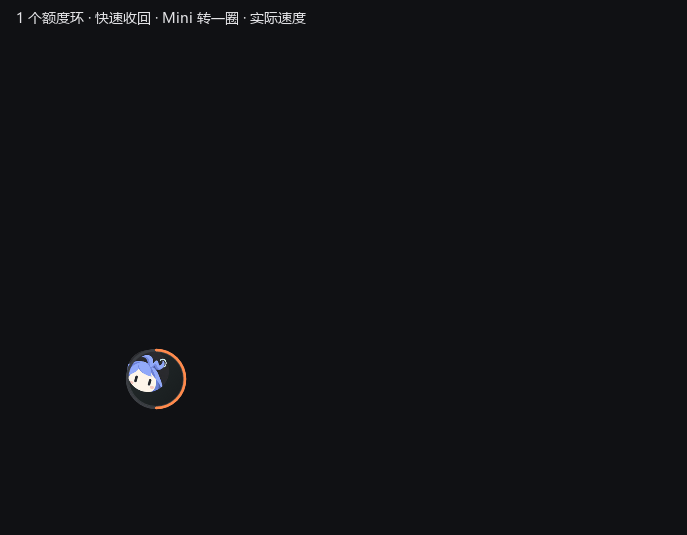
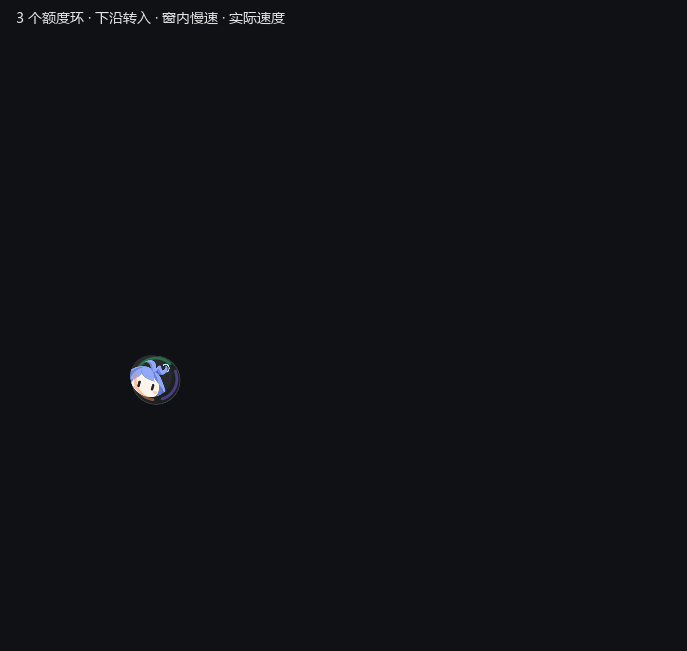

# Wacu · Windows 原生重写验收记录

日期：2026-10-12 · 工程版本：v0.2.0 · 目标：Windows x64。

## 2026-10-12 · Claude 工作时刷新、空闲暂停

- [x] 52 项 Rust 单测通过，包括工作／空闲／等待状态、多会话与后台子任务、进程创建时间校验、配置合并幂等、5 分钟自动门控和 60 秒手动冷却。恢复工作不能绕过限流退避。
- [x] Debug 和无控制台 Release 的原生 hook 回放通过：两类会话合并、上下文压缩不断开工作状态、并发事件不丢失子任务、额度读取不激活检测；对话样例未写入状态文件。
- [x] 隔离配置连接两次保持幂等，原有 hooks 与其他设置保留，备份文件与原文一致；撤销只移除 Wacu 配置。用户偏好未改变，本轮未发起 Claude 额度请求。
- [x] 本机已安装 12 类生命周期 hooks，原有设置保留，原文件备份逐字节核对一致；安装后的本地状态为零个工作会话。已有 CLI／Desktop Code 会话需要重新打开以加载配置。
- [x] 六组额度原生界面与五组交互回归通过，涵盖详情、未登录、限流、菜单、Mini、拖动后点击及设置输入。状态入口保持紧凑，不增加独立按钮行。
- [ ] CLI 与 Desktop Code 的实际任务事件及真实额度联动仍需在新会话体验；本轮验证为本地事件回放，不代表真实 `get_usage` 已验收。

## 2026-10-12 · Mini 剩余额度外圈

- [x] Mini 外圈继续按服务数量分配等大扇区，但彩色弧长由对应服务的剩余额度决定，不显示数字。灰色底环标出每项服务分配的完整扇区，未知数据用更暗的底环；零额度不绘制彩弧，单项满额为真正闭合圆圈。
- [x] Mini 与胶囊共用服务模型，后台额度刷新同步更新两个入口；收回的彩线连续接入同一比例的弧段，保留一圈旋转和原有展开／收起速度。空额度的彩线平滑出现／收回，避免终点冒出彩色点。
- [x] 46 项 Rust 单测、格式检查与 Debug / Release 构建通过。新增检查覆盖 0／25／50／100% 弧长、单项满圈、未知值，以及同位／异位切换起点与静态 Mini 弧段的几何一致性。
- [x] 21 组离线原生额度界面检查通过，其中九组核对 1／2／3 项 Mini 的满额、半额与耗尽，服务数量由实际模型断言；额度读取状态与详情仍正确，Mini 没有数字。
- [x] 12 组同位／左右异位原生切换检查及六组交互回归通过。1／2／3 项旋转过程的原生像素确认彩色区与空白底环比例正确；额度弧段落定前后 RGB 差最大为 1，用户配置未改变。本轮额度均为离线样例。

| 单项满额 | 单项半额 | 单项耗尽 | 三项额度 |
| --- | --- | --- | --- |
|  |  |  |  |

## 2026-10-12 · 剩余额度圆环与百分比

- [x] 胶囊圆环、大号百分比、详情进度条统一使用剩余比例：已用 0% 对应完整彩圈和 `100%`，已用 100% 对应空彩弧和 `0%`，已用 12.5% 对应 `87.5%`。详情已用信息保留原始语义，WorkBuddy 演示也按剩余比例显示。
- [x] 未知、空值与非有限数仍显示 `--`，不当作满额。45 项 Rust 单测、格式检查与 Debug / Release 构建通过，包括满额、耗尽、小数余量、旧数据保留与退出登录清空。
- [x] 12 组离线额度原生窗口检查通过，包含满额／耗尽的胶囊、快览及完整详情，以及未登录、限流。检查满额真实 Slint 截图，圆圈闭合、数字为 `100%`，详情进度条填满；本轮不查询真实 Claude 额度。
- [x] 头像拖动及快览拖动后的交互、同位／异位切换、快速反向、动画开关、任务栏排除检查通过，用户偏好哈希未改变。

满额原生截图（离线样例）：[剩余 100%](screenshots/quota-remaining-full.png)。

## 2026-10-12 · Claude Code 本地额度接入（真实查询待验收）

- [x] 核实本机 Claude CLI 2.1.252 安装与 `auth status --json` 的 claude.ai/firstParty Pro 登录状态；未输出凭据，未核对 Desktop 登录。
- [x] 审查 CC Switch `services/subscription.rs`：Windows 读取 CLI OAuth 文件后请求 Anthropic `/api/oauth/usage`，订阅比例与累计 token 统计为不同来源。Wacu 采用 CLI stream-json `get_usage`，不直接读取 Token。
- [x] 单元测试覆盖控制响应过滤、未知值、百分比、模型周额度、身份/组织切换、API Key、旧数据保留及退出登录清空。
- [x] `check-claude.ps1` 六项离线样例检查通过：胶囊、快览、完整详情、服务设置、未登录、限流；截图明确标注离线样例，仅写入忽略的 `target/`。
- [x] 拖动与点击回归六项通过：entry-controls、capsule-logo-drag、quick-detail、detail-animation、settings-input-check、settings-services；偏好文件未改变。
- [x] 阅读原生完整详情、快览和服务设置截图，未见内容裁切或布局溢出。
- [ ] 真实 `get_usage` 查询及与 Claude `/usage` 的交叉核对。直接 OAuth 请求曾被自动审批拒绝，尚未取得本地 CLI 联网查询的明确许可；本轮不执行真实请求，不启动新版常驻采集器。
- [ ] Desktop 与 CLI 账号一致性人工核对；不假设二者同一登录。

## 2026-10-12 · Codex 真实额度接入

- [x] 使用本机 Codex 的官方 stdio app-server 读取当前 ChatGPT 登录账户，真实返回短周期和每周额度；连续查询读到用量变化。未复制或输出登录 Token，未发起推理任务。
- [x] 36 项 Rust 单测、格式检查、Debug / Release 构建通过。新增覆盖多桶优先、旧版主桶、空值、次窗口、百分比边界、异常数据、旧读数保留、退出登录清空及 UI 小数精度。
- [x] `scripts/check-codex.ps1` 验证圆环、快览、完整详情、服务管理与采集快照同步；快览和详情二次截图检查确认底部按钮完整、每周窗口可读。私人额度截图仅在忽略的 `target/qa-codex-*.png`。
- [x] 六组原生交互回归通过：Mini 即时切换与右键菜单、Logo 拖动、详情拖动恢复、详情淡入淡出、设置输入和服务管理；用户偏好文件校验未改变。
- [x] 后台查询正常间隔两分钟，失败退避；手动刷新合并进行中的请求，重新启用服务立即安排读取。单次总等待 30 秒，Windows Job Object 保证应用退出时回收仍在查询的子进程。
- [ ] 多账户切换、长期离线恢复与持续驻留的资源占用尚未做实机长时间验证。

## 2026-10-12 · 加速收起与 Mini 等分外环

- [x] 展开速度保持不变：异位约 1389ms、同位约 983ms。收起的返回阶段分别缩短到约 617ms／312ms，再用 420ms 完成 Mini 外环的一圈旋转，总计约 1038ms／732ms；没有启用服务时跳过旋转。
- [x] Mini 增加常驻彩色外环，按当前服务数划分等大扇区：三项各占三分之一、两项各占一半、一项占整圈。细缝与圆头保留各段辨识度，颜色使用稳定服务 ID；空列表不绘制彩圈。
- [x] 返回彩线的终态与 Mini 静态弧段共用扇区几何与线宽，接入后顺时针转满一圈，五次缓动使起止速度平滑。转动时带短亮光，单色圈同样可辨；落定后停止帧循环，关闭动画时立即落定。
- [x] 31 项 Rust 单测、格式检查与 Debug / Release 构建通过，新增等分周长、完整一圈、旋转与返回时间轴可逆的测试。原有额度弧段末帧像素差仍为 0；新增原生像素检查确认 1／2／3 项 Mini 的静态扇区与四分之一、半圈、四分之三圈位置颜色正确。
- [x] 12 组同位／左右异位交接检查通过，覆盖 0／1／2／3 项服务、快速反向、动画开关、固定原生几何、任务栏排除与鼠标穿透，用户配置未改变。
- [x] 12 组三档尺寸动画检查、六组 UI 交互回归和 12 组实际退出重启检查通过；拖动后的点击、菜单和设置输入保留，用户配置未改变。四种数量的实际速度 GIF 已更新，每份 91 次原生采样。
- [ ] Explorer 任务栏实际观感、多屏不同 DPI 和旧显卡仍需人工体验。

## 2026-10-12 · 窗内慢速组装与下沿转入

- [x] 跨位置时间轴在进度 0.52 前保持原来的速率，三条彩线到达 Logo 后才平滑减速；完全减速后的阶段用时为原来的 1.65 倍。异位整个展开约 1389ms／收起约 1196ms，同位约 983ms／749ms。
- [x] 窗内彩线先沿边缘下行到额度环下方，再绕过下沿、转到最终额度弧段。保持同一条路径、原有配色和真实额度落点；收起沿相同轨迹反向运行。
- [x] 29 项 Rust 单测、格式检查与 Debug / Release 构建通过。新增测试确认路上速率不变、窗内速率降低、分段时间映射可逆，以及每条线在落定前经过对应额度环下方；原有全轨迹连续性与末帧匹配检查保留。
- [x] 12 组同位／左右异位原生交接检查通过，覆盖 0／1／2／3 项服务、快速反向、动画开关、任务栏排除和鼠标穿透；1／2／3 个圆环共六条额度弧段的落定前后 RGB 差均为 0，用户配置未改变。
- [x] 12 组三档尺寸动画检查、六组 UI 交互回归与 12 组实际退出重启检查通过；独立位置、拖动后点击、右键菜单和设置输入保留，用户配置未改变。四种数量的实际速度 GIF 已更新，每份 97 次原生采样。
- [x] 原生采样的收尾与快速反向等待使用实际阶段时长，并从实际反向点击开始计时；隐藏或被遮挡的窗口在检查前读取最终像素帧，同时确认帧时钟已结束，避免读到旧渲染状态。
- [ ] Explorer 任务栏实际观感、多屏不同 DPI 和旧显卡仍需人工体验。

## 2026-10-11 · 彩线连续卷入额度环

- [x] 修复汇入 Logo 后彩线淡出、额度弧段另行显现的断层。每项服务始终由同一套路径几何驱动：Mini 弧段、分路短线、Logo 弧段、边缘下行短线、额度弧段连续变形，收起使用相同进度反向运行。
- [x] 彩线到达 Logo 后转入胶囊的透明度组继续绘制；隐藏旧边缘彩线与额度彩弧。卷入从服务头像外侧进行，线宽渐变至当前档位的圆环描边，避免直线穿过头像。
- [x] 固定坐标路径使用 `fit: preserve`；末段半径计入 Slint 静态路径的描边内缩，完成卷入时使用相同的 SVG 圆弧端点。新增原生像素检查 `check-flow-continuity.py`：1／2／3 个圆环共六条额度弧段，落定前后 RGB 平均差与最大差均为 0。
- [x] 27 项 Rust 单测、格式检查与 Debug / Release 构建通过。新增测试覆盖彩线全程可见、额度落点与线宽、同位及异位全轨迹的连续性。
- [x] 12 组同位／左右异位交接检查通过，覆盖 0／1／2／3 项服务、固定窗口几何、鼠标穿透、任务栏排除、快速反向和动画开关；用户配置未改变。服务数量在途中改变时先落定，再重新计算布局。
- [x] 12 组局部动画检查、六组 UI 回归及 12 组实际退出重启检查通过；拖动后的服务点击、右键菜单、设置输入和独立位置恢复保留，用户配置未改变。
- [x] 慢速时长保持展开 1080ms／收起 930ms，同位 630ms／480ms；静止后停止帧循环。
- [ ] Explorer 任务栏实际观感、多屏不同 DPI 和旧显卡仍需人工体验。

## 2026-10-11 · 彩线分路汇入 Logo 与慢速切换

- [x] 落地用户确认的“圆环化线 → 分路汇入 Logo → 主环轨道展开”：三条简洁短线在途中沿上下分开的轻弧路径运行，末端先在 Logo 周围成环，再接现有轨道与额度环效果；逆向收回按相同阶段连续归拢。
- [x] 展开 1080ms、收起 930ms；同位省略跨位置阶段，展开 630ms／收起 480ms。点击即时启动，反向从当前进度继续，时长按剩余比例缩短。收尾直接落定，避免 Slint 再次补默认过渡。
- [x] Mini、胶囊仍保留独立保存位置；彩线在固定透明层绘制，原生窗口不逐帧移动或缩放。按物理坐标生成路径，使用绘制层实际 DPI 换算；中途拖动、改尺寸、重置位置或切换停靠侧会先结束当前交接，关闭动画同步隐藏绘制层并取消定时器。
- [x] 固定绘制层预设隐藏所有者与任务栏排除，使用 winit 原生鼠标穿透接口、工具窗和不激活样式。原生检查确认禁用输入，且 `WindowFromPoint` 不返回绘制层。可选桌面像素探针实际读到三条彩线，橙色样本 `COLORREF=0x4c8aff`，确认效果已进入桌面合成。
- [x] 12 组原生交接检查：四种服务数 × 同位／右侧异位／左侧异位。每 30ms 捕获连续帧，核对两个入口与绘制层固定物理坐标、原生大小、任务栏排除及鼠标穿透；验证快速反向、关闭动画与全部八种服务组合的稳定身份。空列表不产生彩线或额度环。
- [x] 12 组局部动画检查（三档大小 × 四种服务数）、六组 UI 回归（Mini、左右键菜单、独立位置、头像拖动、快览、设置输入）及 12 组实际退出重启检查通过；用户配置哈希未改变。菜单验收等待按慢版时长调整。
- [x] 24 项 Rust 单测、格式检查、Debug / Release 构建通过。新增路径测试验证 Logo 落点、中途路线间距、负坐标与 DPI 范围、形变阶段连续性。
- [x] 四种数量的原生 GIF 归档，每份 91 次采样，按实际捕获的桌面坐标合成，以实际速度播放；旧方案 GIF 保留为历史记录。测试预热 Mini 后再捕获起始帧，避免遮挡时首次渲染仍处在启动淡入阶段。
- [ ] Explorer 任务栏实际观感、多屏不同 DPI 和旧显卡上的视觉节奏仍需人工体验；自动检查确认窗口标志、几何和桌面彩线像素，未录制任务栏。

| 0 个额度环 | 1 个额度环 |
| --- | --- |
|  |  |

| 2 个额度环 | 3 个额度环 |
| --- | --- |
|  |  |

## 2026-10-11 · 双端原地圆环接力与任务栏排除

- [x] 删除 `RingTransitWindow`、桌面飞行路径和飞行定时循环。同位与异位统一采用原地接力：Mini 缩收时胶囊立即展开，收起 140ms 时 Mini 接过同色弧段，约 320ms 两端一起落定；原生胶囊 340ms 后隐藏。
- [x] 保留胶囊主环轨道展开 420ms／收起 320ms，以及实际服务数对应的 0／1／2／3 个额度环、稳定服务 ID、原有用量与配色。Mini 与胶囊保存坐标完全独立，跨位置不会增加点击响应时间。
- [x] 使用 Slint winit 窗口创建前属性钩子，设置隐藏所有者、排除任务栏与默认不激活；隐藏所有者在 winit 初始化 DPI 后创建。避免窗口先显示、再移除任务栏按钮的时序；工具窗样式无变化时不重复刷新。菜单、设置和详情按需主动激活。
- [x] 12 组原生交接检查通过：四种服务数 × 同位／右侧异位／左侧异位。每 30ms 采样期间核对两窗物理坐标不变、隐藏所有者与无 `WS_EX_APPWINDOW`，并验证立即启动、快速反向、动画开关与过时定时器取消。每组切换全部八种服务开关组合并读取实际像素帧。
- [x] 12 组局部动画检查通过，覆盖三档大小 × 四种服务数。Mini、入口控制、独立位置、头像拖动、用量快览和设置输入共六组 UI 回归通过；菜单及设置额外检查任务栏排除状态。12 组实际退出重启检查通过，用户配置哈希未改变。
- [x] 20 项 Rust 单测、格式检查与 Debug / Release 构建通过。
- [x] 四种数量的原生交接 GIF 已归档，每份 51 次采样、28–29 个编码帧；重复静态帧由编码器合并。按实际捕获的桌面坐标合成，2 倍慢放仅用于观察；旧飞行 GIF 保留为历史记录。
- [ ] Explorer 任务栏的实际观感、多屏不同 DPI 与旧显卡上的视觉节奏仍需人工体验；自动检查确认窗口所有者和任务栏标志，未录制 Explorer 任务栏。

| 0 个额度环 | 1 个额度环 |
| --- | --- |
|  |  |

| 2 个额度环 | 3 个额度环 |
| --- | --- |
|  |  |

## 2026-10-11 · 主环拉链、动态数量与异位交接

- [x] 主环伸长为轨道，彩色弧段沿边缘下行，在服务位置依次闭合成额度环；收起沿同一阶段反向收回。轨道展开 420ms、收起 320ms，稳定后回到原有用量和配色。
- [x] Mini、胶囊与飞行主环共享启用服务模型；弧段数、配色、闭合位置、错位节奏及胶囊高度随实际 0／1／2／3 项服务变化。空列表只有品牌主环及未启用提示，无彩色额度环。
- [x] 异位交接从 Mini 中心飞到胶囊头像中心，反向则先收回轨道再飞回 Mini。飞行使用约 100–260ms 的短弧线，同位中心距离小于 24 个物理像素时省略飞行；临时原生窗口设置不激活与穿透样式，不写入保存坐标。
- [x] 12 组原生交接检查通过：四种服务数 × 同位／右上飞行／左上飞行。检查实际中间位置与可见像素、目标落点、独立坐标、途中快速反向、动画关闭后即时交接及旧定时器取消。
- [x] 每组交接检查均切换全部八种服务开关组合，核对可见数量与稳定服务 ID，包括仅 Codex 和仅 WorkBuddy 的情况，并读取实际原生帧。
- [x] 12 组局部动画检查通过：三档尺寸 × 四种服务数，检查外壳轮廓展开／收回、固定原生尺寸、阶段顺序、最终状态及快速反向。
- [x] Mini、入口控制、独立位置、头像拖动、用量快览五组 UI 回归及 12 组退出重启检查通过；用户配置哈希未改变。21 项 Rust 单测、格式检查、Debug / Release 构建通过。
- [x] 飞行验收按完成状态退出，原生像素帧在退出后编码；快速反向检查持续读取窗口帧，避免测试桌面的遮挡导致读取旧阶段。归档包含实际桌面坐标，GIF 按这些坐标合成，四种数量每份 51 次采样、47–49 个编码帧，使用 2 倍慢放方便观察。
- [ ] 多屏不同 DPI 与旧显卡上的视觉节奏仍需人工体验；负坐标路径和弯曲范围已由单测覆盖。

| 0 个额度环 | 1 个额度环 |
| --- | --- |
|  |  |

| 2 个额度环 | 3 个额度环 |
| --- | --- |
|  |  |

## 2026-10-11 · 圆环拆分、接力展开与聚合归一

- [x] Mini 边缘在切换时浮现服务配色弧段；三个额度环从顶部头像处依次分离，沿纵轴弹出归位，外壳跟随最下方圆环展开。亮弧沿额度环接力运行，图标和百分比随落位显现。
- [x] 展开时间轴 260ms、收起 180ms，各行展开起点错开约 23ms；收起时下方环先叠回头像，聚合完成后淡出，200ms 后隐藏原生胶囊窗口。快速反向继续取消过时的隐藏定时器。
- [x] 静止后回到原有额度环、颜色、文字和窗口位置；动画开关关闭时即时到达终态，无持续帧循环。
- [x] 20 项 Rust 单测、九组原生动画检查通过，覆盖三档尺寸 × 0／1／3 个服务、环顺序及终态、弹性位移范围、外壳边界、快速反向与关闭动画。
- [x] Mini、入口控制、顶部头像拖动、用量快览四组 UI 事件回归通过；12 组实际退出重启检查通过，形态与独立位置恢复正常，用户配置未改变。格式检查、Release 构建通过。
- [x] 动画检查先缓存原生像素帧，退出后再编码 PNG，避免压缩拖慢采样；新增 Mini 交接及后段聚合帧。`entry-ring-split.gif` 并排展示两窗的实际帧，播放间隔仅供观察；旧 GIF 保留为历史记录。
- [ ] 多屏不同 DPI、旧显卡及真实鼠标连续操作下的视觉节奏仍待人工体验。


## 2026-10-11 · 额度圆环联动

- [x] 移除独立光圈、扫光、粒子和 Logo 旋转；沿用额度环自己的配色，以同一入场阶段控制底环绘制、彩色弧增长、环径／中心图标恢复和百分比淡入。
- [x] 外壳仍为 180ms 展开／140ms 收起，额度环 220ms 内落定，各行错开约 22ms。服务保持原位并轻移 6px，收起时下方环先回收，不再从头像横向散开。
- [x] 圆弧支持小数进度，动画不改用量模型或百分比目标值；完成后回到静态路径，关闭动画时立即到达终态。
- [x] 19 项 Rust 单测、九组真实帧动画验收通过：三档尺寸与不同服务数、圆环顺序及终态、快速反向、固定窗口尺寸和动画开关。
- [x] 四组 UI 事件回归及 12 组实际退出重启检查通过，用户配置未改变；格式检查、Debug / Release 构建通过。
- [x] 当轮真实帧已归档至通用入口截图，历史 GIF 为 `entry-rings.gif`；此前 `entry-aurora.gif` 保留为历史效果记录。通用 PNG 随后续动画版本更新。


## 2026-10-11 · 极光能量切换

- [x] Mini 双层光环；胶囊头像轻旋回正、薄荷绿／蓝紫双圈扩散、圆角内部扫光、双侧光轨与六颗微光粒子，服务环从头像附近依次散开，收起反向聚拢。
- [x] 主体保持 180ms 展开／140ms 收起，独立尾光 320ms 内结束；稳定后特效透明，无空闲动画。动画关闭时主体及特效同时结束。
- [x] 三档尺寸 × 0／1／3 项服务共九组真实帧检查通过，验证实体轮廓展开／收起、快速反向、固定原生窗口尺寸、尾光结束和关闭动画即时交接。
- [x] 帧检查用 alpha > 180 区分实体轮廓与外发光；交接测试先结束启动动画并绘制 Mini 基准帧，避免 Windows 遮挡后的透明读回。普通 Mini 启动截图另行检查。
- [x] 四组点击／拖动／菜单／详情 UI 回归及 12 组退出重启恢复检查通过，用户配置未改变。格式检查、Debug / Release 构建通过。
- [x] 标准尺寸的真实采样帧已归档；`python scripts/render-entry-motion.py` 使用 Pillow 合成 GIF，重复读回由编码器合并，预览播放速度仅供观察。


## 2026-10-11 · 退出后恢复窗口形态

- [x] 新增 `entry_view` 保存 Mini／胶囊，旧配置缺失该字段默认 Mini；与独立位置及旧托盘 `mode` 分开保存。
- [x] 启动直接恢复上次入口和对应位置；恢复胶囊后超过三秒仍显示。打开设置或更改常驻选项不改变入口形态。
- [x] 切换开始即记录目标形态，退出再次保存；快速反向切换及动画中途退出后重新启动恢复最后选择的形态。
- [x] 18 项 Rust 单测、格式检查、Debug / Release 构建通过。
- [x] `check-entry-session.ps1` 使用隔离配置实际退出并启动 12 个进程，验证旧配置、Mini／胶囊恢复、菜单／设置退出、动画开关、快速切换与坐标独立性；用户配置未改变。
- [x] Mini 点击／拖动、右键菜单、独立坐标与设置输入共四组 UI 回归，以及旧版 popup / pinned 启动检查通过。

## 2026-10-11 · 紧凑简洁菜单

- [x] 菜单窗口 184×116 → 128×84px，主体 116×72px；两行高 28px，文字 12px，图标 14px，去除图标彩色底块。
- [x] 石墨色背景与 9px 圆角、轻灰细边、柔和阴影；悬停改为低对比灰色，退出图标仅在高亮时使用淡红色。
- [x] Debug 构建与格式检查通过；正常态／高亮态真实截图已更新并检查，Mini 拖动与点击、菜单设置／退出、键盘选择、Esc、失焦关闭和左右键即时切换回归通过，用户配置未改变。
- [x] Release 构建通过。


## 2026-10-11 · 项目同款深色图标菜单

- [x] 菜单改为 Slint 自绘：石墨渐变、12px 圆角、细边与阴影，绿色悬停／键盘高亮；设置前使用齿轮图标，退出前使用新增电源 SVG。
- [x] 共享 `EntryMenuWindow` 独立显示，184×116px；Mini、胶囊头像、服务行和背景右键都进入同一个菜单，位置完整限制在屏幕工作区，不保存临时菜单坐标。
- [x] 原生事件检查：鼠标选择设置、鼠标／键盘选择退出、Esc 和失焦关闭；左右键操作不恢复双击等待，拖动及位置回归保留。
- [x] 17 项 Rust 单测及 24 组现有 UI 回归通过；新增正常态／高亮态两幅真实 Slint 截图已归档，用户配置未改变。`capture-ui.ps1 -Only` 可按用例名只生成指定截图。
- [x] Release 构建通过。
- [ ] 多屏不同 DPI 与实际桌面鼠标体验仍待人工确认；失焦关闭使用原生窗口事件分发验证。


## 2026-10-11 · 左键即时切换 / 右键菜单

- [x] 移除双击设置入口、单双击判定状态及定时等待；Mini 左键直接展开，胶囊头像左键直接收起，仍区分超过 7px 的拖动。
- [x] 两个入口均使用 Slint ContextMenuArea 弹出 Windows 原生菜单，仅有“设置”“退出”；右键不再直接进入设置。
- [x] 原生事件回归在左键回调返回时确认目标窗口已显示；两个入口的实际原生菜单均通过键盘选择验证设置与退出回调。退出用例在隔离测试进程中计数，正式程序调用 quit_event_loop。
- [x] Esc 取消菜单、拖动不切换、Mini/胶囊独立位置、17 项 Rust 单测及 24 组原生 UI 回归通过，真实用户配置未改变。
- [x] 9 组动画回归与 Release 构建通过，原有 180ms 展开／140ms 收起动效保留。
- [ ] 用户实际桌面鼠标选择菜单、多屏 DPI 和不同显卡体验仍待人工确认。

## 2026-10-11 · 缩短单击弹出等待

- [x] 定位到延迟来自完整 Windows 双击判定间隔，加上 420ms 展开动画；单双击判定改为 100–200ms，系统设置更慢时最多等待 200ms。
- [x] 保留快速双击头像打开设置、右键 Mini 设置、拖动取消待执行单击；较慢的双击现在按单击处理，避免单击长期等待。
- [x] 展开动画 420 → 180ms，收起 280 → 140ms；Mini 退场 100ms、返回 180ms，窗口显示准备缩为一帧 16ms，服务项在展开进度超过 85% 时启用。
- [x] 原生单击回归在 240ms 的检查点确认胶囊可见且已开始展开；动画用例在 225ms 确认展开完成，覆盖三档尺寸 × 0／1／3 项服务的 9 组组合。短动画帧高度保持单调，允许繁忙桌面采样跳帧。
- [x] 18 项 Rust 单测、格式检查、24 组原生 UI 截图／交互回归通过；独立位置、快速反向与关闭动画保留，真实用户配置哈希未改变。
- [x] Release 构建通过。
- [ ] 不同鼠标双击节奏、高 DPI 和旧显卡上的实际体验仍待人工确认；240ms 是本机原生事件检查点，不是所有电脑的响应承诺。

## 2026-10-11 · 双击头像打开设置 / 移除底部齿轮

- [x] 胶囊底部设置齿轮连同所占空白整行删除，三项服务的紧凑／标准／宽松原生窗口高度从 378／411／444px 调整到 322／349／376px。
- [x] Mini 和完整胶囊顶部的品牌头像都支持**双击打开设置**；单击依然展开／收起。Mini 原有右键打开设置仍可用。
- [x] Rust 使用 Windows `GetDoubleClickTime` 判别，双击取消第一次待执行的单击；拖动或 Mini 右键也取消待执行切换，防止意外展开／收起。
- [x] 新增 `IconClicks` 单双击取消与时间边界单测；原生 Slint Mini/胶囊双击和独立位置交互用例纳入 `capture-ui.ps1`。
- [x] 完整 UI 快照回归通过，用户原始配置文件校验无变化。
- [ ] Release 真鼠标双击、不同 Windows 双击速度设定及高 DPI 场景仍需人工体验。

## 2026-10-11 · Mini ↔ 胶囊能量动效

- [x] Mini 缩收轻旋、返回回弹与单次外圈脉冲；胶囊由顶部圆形展开，服务环依次浮现，青绿色边缘微光随展开／收起移动。
- [x] 原生窗口尺寸保持固定；固定内容布局从顶部裁切，Logo 命中区随表面轻移，圆环和数字不被拉伸。
- [x] `check-entry-motion.ps1 -Archive` 通过三档尺寸 × 0／1／3 项服务的 9 组验收：实际像素可见高度逐步增大／缩小，Mini 退场帧收缩；中途连续反向、关闭动画立即交接均通过。
- [x] 两窗共享切换代次，过时显示／隐藏定时器失效；退场窗禁用点击，服务与齿轮在展开基本完成后启用。
- [x] 首次创建 HWND 后读取实际尺寸再定位，修复首启 Mini 坐标越界、第一次收起位置偏移；独立位置回归通过。
- [x] 17 项 Rust 单测、格式检查、24 组现有原生 UI 截图／交互回归通过；真实用户配置哈希未改变。
- [x] Windows Release 构建与隔离配置启动检查通过。
- [ ] 多屏不同 DPI、旧显卡和真实鼠标操作下的动画节奏仍待人工验收；原生 Slint 事件与渲染快照不等同于以上验收。

原生关键帧：

| 展开早期 | 展开中段 | 展开完成 | 收起中段 |
| --- | --- | --- | --- |
|  |  |  |  |

## 2026-10-11 · Mini 与胶囊分离位置

- [x] `mini_position` 和 `saved_position` 分别控制 Mini 与胶囊，切换显示时不再按另一窗口中心坐标重算。
- [x] Mini 首次默认右下，胶囊首次默认右侧中间；拖动胶囊后收起，Mini 仍回到自己的右下坐标。
- [x] 行为设置新增“恢复 Mini 默认位置”和“恢复胶囊默认位置”，重置操作不影响另一窗口。
- [x] 独立配置自动验收：不同高度两套坐标，展开/折叠两轮，模拟拖动后的坐标记忆、JSON 存取与独立恢复位置，均通过。
- [x] `capture-ui.ps1` 新增 `mini-independent-positions` 回归，完整 Slint 截图回归通过，未更改真实用户配置。
- [x] 17 项 Rust 单测通过；Windows Release 隔离配置启动，UI Automation 确认 Mini 显示在右下角 (1829,941)，JSON 中单独保存的胶囊右中坐标 (1799,310) 未被覆盖，私有内存约 68MB（当前测试机）。
- [ ] 当前远程会话不允许自动化测试程序可靠抢占前台焦点，因此真实鼠标注入点击结果未作为通过项；用户桌面上的鼠标体验和多屏 DPI 切换仍待人工验收。

## 2026-10-11 · Mini 悬浮图标入口

- [x] 正式版不再显示系统托盘图标，使用同进程 66×66px MiniWindow 作为唯一常驻入口。
- [x] 单击 Mini 展开原有纵向胶囊；单击胶囊顶部头像收回 Mini。
- [x] 原生 Slint 事件测试：超过 7px 才判定拖动；短按不误触拖动，拖动不误触展开。
- [x] Mini 右键打开设置，关于页新增“退出 Wacu”，取消托盘也保留退出路径。
- [x] Mini 坐标通过 `mini_position` 独立保存；新版展开胶囊时使用单独的 `saved_position`。
- [x] 胶囊三档尺寸、详情动画、服务管理保留；Mini 快照和点击测试加入 `capture-ui.ps1`。
- [x] Windows Release 真鼠标测试：Mini 拖动位置从 (1905,516) 到 (1806,461)，隔离配置中的 `mini_position` 随鼠标抬起正确保存。
- [x] Windows Release 真鼠标单击：Mini 展开 88×378 胶囊，点击顶部头像又收回 66×66 Mini。
- [x] Windows Release 右键 Mini：保持 Mini 可见，详情胶囊仍隐藏，同时打开设置；任务栏 UI Automation 中 Wacu 通知区图标数为 0。
- [x] Release 纯 Mini 空闲 6 秒：私有内存约 67.9 MB、工作集约 72 MB、CPU 样本 0ms；打开设置期间私有内存约 98.8 MB。
- [ ] 多显示器高 DPI 切换、全屏游戏与锁屏行为仍需人工验收。

## 以下为旧版系统托盘历史验收

## 当前轮：拖动后的点击恢复与小手光标

- [x] 原生拖动延后到鼠标按下事件处理完成后执行，结束时补发 Slint 鼠标释放和位置事件，清除残留的 TouchArea 捕获；拖动命中区使用明确局部边界。
- [x] Logo、胶囊顶端、设置标题栏和透明度滑杆统一使用 `pointer` 小手；不再使用 `grab` 的拖动箭头光标。
- [x] 两种模式分别检查三项服务的选择与详情、设置入口，并模拟原生拖动吞掉鼠标抬起，再调用生产恢复函数验证点击仍有效，通过；未使用真实鼠标进入 OS 拖动循环。
- [x] 设置标题栏捕获恢复、透明度滑杆点击／拖动／右方向键与位置下拉框检查通过，滑杆保留原生键盘焦点和无障碍处理。
- [x] 14 项 Rust 测试、格式检查、启动显隐与原生界面检查通过，真实用户配置未改变。
- [x] Release 构建、十档 EXE 图标资源及隔离配置启动检查通过。

## 前轮：Logo 拖动与启动预览

- [x] 顶部 Logo 与顶端拖动区在弹出、常驻模式均启用；调用现有 Win32 拖动接口，结束时立即保存位置，拖动期间暂停自动隐藏。
- [x] 程序启动先显示胶囊；弹出模式约 3 秒后淡出，悬停暂缓隐藏，拖动或打开详情／设置结束启动预览；常驻模式保持显示。
- [x] `scripts/check-startup.ps1` 检查原生窗口在启动 300ms 时已显示、3700ms 时弹出模式已隐藏而常驻仍可见，通过。
- [x] `scripts/check-position.ps1` 使用 Slint Pointer 事件验证两种模式的 Logo 拖动入口，并检查位置切换与保存，通过；该输入检查未进入真实 Win32 鼠标拖动循环。
- [x] 14 项 Rust 测试、格式检查、17 张原生快照及隔离控件输入检查通过；真实用户配置未改变，行为页说明完整显示。
- [x] Release 构建、十档 EXE 图标资源及隔离配置启动检查通过。

## 前轮：两种模式共享位置与圆头进度弧

- [x] 弹出和常驻共用保存的桌面坐标，移除托盘／鼠标锚点定位；拖动后切换立即记录位置，贴边隐藏时保留可见位置。
- [x] 已显示的弹出胶囊同样响应左右位置和重置；首次展开保存默认侧边位置，之后反复展开和切换保持一致。
- [x] 原生进度弧使用圆头端点与 56×56 显式 viewbox，去除零长度占位线段；0% 无彩色杂点，100% 使用闭合路径。
- [x] `scripts/check-position.ps1` 在隔离配置中检查即时拖动、弹出／常驻切换、贴边隐藏、左侧定位和保存，通过；真实用户配置未改变。
- [x] 12 项 Rust 测试、格式检查、17 张原生快照和隔离控件输入检查通过；三档圆头端点清晰，窗口尺寸保持原样。
- [x] Release 构建、十档 EXE 图标资源和隔离配置启动检查通过。

## 前轮：品牌程序图标与柔和光晕

- [x] EXE 文件、胶囊／详情／设置窗口及托盘图标统一使用用户 Logo，删除旧托盘 SVG 和运行时绘制的旧图标。
- [x] 原图保留不变；生成圆形透明 PNG 与 16／20／24／32／40／48／64／96／128／256px ICO，用 Windows 资源编译器嵌入 EXE。
- [x] `python scripts/check-icon.py` 验证 Debug 和 Release EXE 的十档实际图标资源与源 ICO 字节完全一致。
- [x] 移除七层描边光晕，改用连续高斯透明渐变与柔和弧线端点；预览确认三档及选中状态无生硬分层，百分比保持清晰。
- [x] 12 项 Rust 测试、格式检查、17 张原生快照和隔离控件输入检查通过；真实用户配置未改变。
- [x] Release 构建及隔离配置启动检查通过。

## 前轮：圆环同色外发光

- [x] 橙／绿／紫圆环增加同服务色光晕，进度弧与选中状态略亮；七层渐窄透明路径位于清晰的灰色轨道和彩色进度弧下方。
- [x] 光晕随紧凑／标准／宽松档位缩放；三档与选中原生快照中，数字保持清晰，窗口和布局尺寸保持原样。
- [x] 9 项 Rust 测试、17 张原生外观快照及隔离控件输入检查通过，真实用户配置未改变。
- [x] Release 构建及隔离配置启动检查通过。

## 前轮：百分比间距与字体

- [x] 百分比数字在紧凑／标准／宽松档上移 4／7／7px，靠近所属圆环；服务项与胶囊尺寸保持原样。
- [x] 数字使用 Windows 系统字体 Bahnschrift，字重 500，字号保持 12／14／16px；三档原生快照中无裁切或重叠。
- [x] 9 项 Rust 测试、17 张原生外观快照及隔离控件输入检查通过，真实用户配置未改变。
- [x] Release 构建及隔离配置启动检查通过。

## 前轮：收紧设置入口下方留白

- [x] 设置按钮行高度与 16／20／24px 图标一致，消除原先按钮行内的额外空白；图标到底端的内边距统一为 16px。
- [x] Logo、服务项、图标尺寸及两端到服务区的间隔保持原样；标准窗口由 88×378px 收紧为 88×358px，紧凑 72×284px，宽松 104×420px。
- [x] 9 项 Rust 测试、17 张原生外观快照和隔离控件输入检查通过，真实用户配置未改变；三档底部图标完整显示。
- [x] Release 构建及隔离配置启动检查通过。

## 前轮：顶部品牌 Logo、胶囊外形与圆环背景

- [x] 保留用户提供的 docs/logo.png 原图，生成 2x 小尺寸 PNG 并平滑采样，避免高分辨率图直接缩小的锯齿；顶部 Logo 为 32／40／48px，常驻时支持从 Logo 区拖动。
- [x] 恢复半圆端头胶囊，保留纯色主体；圆环线宽 3／4／5px，增加相同坐标的灰色背景轨道。
- [x] Logo 与设置入口到服务区的间隔统一为 12／16／20px；设置图标 16／20／24px，点击区域保持 32／40／48px。默认窗口 88×378px，紧凑 72×300px，宽松 104×444px。
- [x] 9 项 Rust 测试、17 张原生外观快照和隔离控件输入检查通过，真实用户配置未改变。
- [x] Release 构建及隔离配置启动检查通过。

## 前轮：调整圆角并去除悬浮窗渐变

- [x] 保留上一版圆形角色与细进度弧；主体与角色使用纯色，去除悬浮窗渐变。
- [x] 悬浮窗紧凑／标准／宽松圆角从 24／32／40px 改为 20／24／28px，窗口和服务项尺寸保持原样。
- [x] 三档、选中与空状态原生快照、控件输入检查、Release 构建及启动检查通过。

## 前轮：去除悬浮角色的固定圆形边框

- [x] 去除灰绿圆环、黑色圆盘与圆形选中描边，保留 2px 用量进度弧；选中光晕放在角色本体。
- [x] 胶囊三档、服务项及点击区域尺寸保持原样。
- [x] 原生编译、三档与选中状态快照、控件输入检查及 Release 启动检查通过。

## 前轮：收紧设置与详情，保留悬浮胶囊尺寸

- [x] 快览从 370×528px 收紧为 296×422px，完整详情从 370×765px 收紧为 296×612px；文字、图表、卡片及按钮同步采用 1.0 倍排版。
- [x] 设置从 530×775px 收紧为 460×600px，导航 116px，设置项 54px，开关 40×22px；五个分类保持完整。
- [x] 胶囊三档主体、圆环、百分比与设置触点保持原有大小。
- [x] 更新隔离配置输入检查坐标；视觉预览跳过系统托盘注册，正式运行保留托盘。
- [x] 17 张外观快照、原生滑杆与下拉选择检查通过，用户配置哈希一致。
- [x] Rust 格式、9 项测试、Release 构建及隔离配置启动检查通过。
- [ ] 完整跨屏、不同 DPI 与真实鼠标人工验收。

## 前轮：校准设计图比例、材质与控件

- [x] 按用户确认保留 Claude Code、Codex、WorkBuddy 三项服务。
- [x] 快览 370×528px、完整详情 370×765px、设置 530×775px；分别校准标题栏、卡片留白、导航宽度与按钮图标位置。
- [x] 石墨色渐变表面、白色文字层次、55×30px 开关、圆角下拉框、蓝色滑杆与更细的图表柱。
- [x] 修复 Slint 八位颜色顺序导致的透明阴影与紫色选中光晕；箭头对齐服务圆环中心。
- [x] 17 张原生外观快照归档，另对位置下拉框和透明度滑杆分发原生指针／键盘事件，断言位置切换为左侧、透明度落入预期范围；保留下拉弹层截图。
- [x] 输入检查强制隔离 APPDATA；预览前后真实用户配置哈希一致。
- [x] 9 项 Rust 测试、格式检查和 Release 构建通过，正式 EXE 完成隔离配置的 2 秒启动检查。
- [ ] 完整 Windows 鼠标、跨屏与不同 DPI 的人工验收。Slint 事件分发检查不代表以上验收已完成。

下方各轮记录保留为历史证据；当前尺寸以本节和 UI_SPEC 为准。

## 前轮：放大界面并增加胶囊尺寸选择

- [x] 默认胶囊主体从 48px 增大到 64px，圆环从 36px 增大到 50px；数字 14px、设置触点 40px。
- [x] 外观页提供紧凑／标准／宽松三档，偏好立即保存，旧配置缺失字段时采用标准档；原生窗口布局后重新约束位置并同步定位详情。
- [x] 详情与设置由统一 1.25 倍 Token 放大，字体、图标、间距和触点一起变化；完整详情 370×730px、设置 530×700px。
- [x] 9 项 Rust 测试、格式检查及 Release 构建通过，最终 EXE 完成隔离配置的 2 秒启动检查。
- [x] 17 张原生快照（包含三档胶囊大小、空状态和设置分页）生成并检查；预览前后用户配置哈希一致。
- [ ] 三档大小选择的真实鼠标回归及不同 DPI／多屏实机检查。

以下记录为前轮的设计落地验收，尺寸已由本节和 UI_SPEC 更新。

## 前轮：再次对照两页设计图

本节记录前轮源码；其中尺寸与截图已被最新一轮和 UI_SPEC 替代。

- [x] 原生胶囊主体改为 48px，36px 进度环、20px 双眼角色、32px 齿轮触点，橙／绿／紫采用设计色值。
- [x] 完整详情有四个筛选、24 根演示柱、五个刻度、正确左侧开始的进度条与三列信息行。
- [x] 设置面板有深色 Fluent 下拉框与滑杆，常规页集中放置四个开关、透明度、位置、语言和版本入口。
- [x] 9 项 Rust 测试通过：包含旧配置兼容、新配置往返、服务 ID、已用／剩余一致性、屏幕边缘触点及 DPI 坐标。
- [x] 胶囊 0–3 项、选中态、快览、四种详情筛选与五个设置分页共 15 张原生快照生成并逐屏检查。
- [x] 注册表开机启动、默认浏览器入口和贴边恢复行为完成源码接入；预览检查不修改真实设置或注册表。
- [x] 最终 Release 构建成功，使用隔离 APPDATA 进行进程启动检查，2 秒内保持运行；正式用户配置不参与该检查。
- [ ] Windows 实际重新登录启动、贴边恢复的真实鼠标操作、Popup 焦点与详情交互的完整人工回归。
- [ ] 跨多屏、不同 DPI 的真实拖动及长时间性能回归；此前旧版本内存样本不能直接代表本轮版本。

当前用量仍为演示，语言仅提供简体中文，更新入口查看 GitHub Releases。

## 架构变化

此前 Tauri/React/WebView2 已经从源码和依赖清单中清理，现采用单个 Rust 进程、Slint 原生绘制、SystemTrayIcon 和少量 Win32 API。

**注意：此版本的所有额度百分比仍为明确标注的演示数据，不涉及 Codex / Claude / WorkBuddy 真实账户。**

## 已通过的检查

- [x] Slint 1.18 UI 编译（胶囊、详情、设置、托盘）。
- [x] Rust + Windows API 编译检查。
- [x] 7 项 Rust 测试（窗口放置、旧配置兼容、视觉设置持久化、圆形进度和过滤服务 ID）。
- [x] Windows 进程启动并持续运行。
- [x] Windows 无 WebView2 依赖，未观察到 WebView2 子进程。
- [x] Windows 常驻胶囊窗口创建；窗口位置及尺寸经 UI Automation 验证。
- [x] Slint 原生快照确认胶囊圆角背景和进度配色已绘制（418×106 快照，包含非透明及彩色像素）。
- [x] Windows Shell 托盘图标实际注册，UI Automation 在任务栏溢出区识别到 Wacu。
- [x] 真实鼠标事件点击 Codex / Claude Code 进度环能打开对应详情窗口。
- [x] 胶囊设置按钮打开独立设置窗口，关闭 Codex 后偏好成功持久化，剩余 Claude Code 仍正确映射到原服务。
- [x] 常驻胶囊可从顶端拖动；实测移动 (-200,-60) 像素后坐标正确写入 JSON。
- [x] 从设置选择点击弹出会保存 popup 模式并隐藏胶囊。
- [x] 服务数量从 3、2、1 到 0 时，高度分别按内容调整；0 服务时留出 244px 的空状态空间。
- [x] 胶囊底部两个操作按钮和详情页刷新按钮已经通过屏幕截图确认位于圆角背景内。
- [x] 设置页服务名称左对齐、开关靠右；新版设置页采用可拖动的无边框自绘深色标题栏。

## 2026-10-10 设计图还原验收

- [x] 采用 Slint 重新缩窄为 62px 胶囊，默认三项高度 275px，底部只留设置入口。
- [x] 实现平台快览（302×399px）和完整详情（302×586px），两种状态均通过原生帧截图检查。
- [x] 设置窗口改为 500×574px 深色分栏，包含五个分类导航与真实可保存的选项。
- [x] 由应用原生渲染器生成胶囊、快览、完整详情与五个设置分页快照，不依赖 Windows 鼠标注入。
- [x] 对照设计图重点修复数据行横向三列、设置项文字基线、右侧开关、滑杆数值及文本自动伸缩错位。
- [x] 将五张代表性的原生截图归档于 docs/screenshots，便于用户实际比较。
- [x] 修复详情信息行的图标/字段/数值三列基线、百分比双端对齐、图表刻度按左右锚定。
- [x] 修复设置标题/导航/设置行统一网格；五个设置分页均生成原生截图。
- [x] 为各分类直接文字设置固定高度以避免 Slint 自动伸缩造成大块空白；透明度滑杆与右侧数值同一水平行。
- [x] 修正进度环与主胶囊比例，修复缺字方框与柱子生长方向问题。
- [ ] 真实鼠标完整操作新版设置页、详情页及动画；需进一步做正式交互回归。

详细的尺寸、颜色和动效见 [UI 设计落地规范](UI_SPEC.md)。

## 胶囊三档尺寸重定义（2026-10-11）

- [x] **紧凑**改为旧“标准”：原生窗口宽 **88px**、三项服务高 **378px**；圆环 **50px**。
- [x] **标准**改为旧标准与宽松的中间值：原生窗口宽 **96px**、三项服务高 **411px**；圆环 **56px**。
- [x] **宽松**保持：原生窗口宽 **104px**、三项服务高 **444px**；圆环 **62px**。
- [x] 头像、数字字号、行间距、底部齿轮按钮尺寸同步调整，不只是拉宽窗口。
- [x] 旧标准配置加载后自动迁移为新紧凑；新安装默认新标准；重复加载已迁移的配置不会再次修改。
- [x] 三档 Slint 原生截图及详情动画、拖动恢复、设置页均通过回归验收；用户真实配置未被修改。
- [x] 用独立 APPDATA 配置启动 Windows Release，通过 UI Automation 实测：新默认 96×411px、旧标准迁移后 88×378px、旧宽松 104×444px；三种情况均正常启动。

## 详情窗口显示/关闭动效回归（2026-10-11）

- [x] Slint 详情面板新增 175ms 淡入淡出及 6×5px 轻位移；尊重显示动画开关。
- [x] 关闭按钮与失焦退出共用延时隐藏处理，不再立刻消失。
- [x] Debug 原生测试覆盖：开场/退出状态、快速关闭再打开取消过时定时器、动画关时立即隐藏。
- [x] Debug 原生帧检查确认动画中间与完成阶段的 Alpha 通道实际变化（不只是属性状态切换）。
- [x] 拖动胶囊仍立即隐藏详情，停下后重新定位并淡入，保留原服务选中状态。
- [ ] 动画节奏在高 DPI、旧显卡与真实鼠标快速连续操作下的人工视觉验收。

## 胶囊详情拖动逻辑回归（2026-10-11）

- [x] 选中服务时的蓝色三角指示器已移除，保留原选中项高亮。
- [x] Windows 原生移动循环开始前暂时隐藏已展开详情；完成移动后按主胶囊新坐标重新贴边恢复。
- [x] 原生 Slint Debug 验证：详情隐藏、主胶囊移动、原服务选择保持、详情新位置和恢复显示均通过。
- [x] 将此验证并入 `capture-ui.ps1` 快览回归，全套截图生成通过，未改动用户配置。
- [ ] 在用户实际 Windows 桌面进行鼠标拖动、双屏切换和 Popup 失焦交互复核。

## 还需实测的内容

- [ ] 由用户在真实 Windows 桌面人工验收托盘左键弹出及右键菜单（自动化模拟点击不稳定，不据此认定功能通过或失败）。
- [ ] Popup 失焦收起及再次弹出、短时间快速切换焦点的完整人工交互。
- [ ] 图标悬停动画、进度环动效、透明边缘及高 DPI 字体的人工视觉验收。
- [ ] 双屏幕副屏、任务栏自动隐藏和不同缩放比例。
- [x] Release 版本在当前测试机器上的短时隐藏/常驻内存和 CPU 基准。
- [ ] Release 在老旧显卡上的渲染器兼容、启动时间及长期运行。
- [ ] Windows Explorer 重启后系统托盘恢复。
- [ ] 如果图形后端在少数旧电脑不可用，增加后备渲染策略。

右键菜单已有“显示 / 隐藏胶囊”备用操作。当前并未将以上待测项视为已经通过的功能；UIA 不能稳定驱动 Windows 通知区的点击事件，但已证明 Slint 普通窗口接受真实鼠标输入。

## Release 空闲性能基线

2026-10-10 本机 Windows x64，Release 版，每种模式稳定后采样 10 秒。

| 指标 | 点击弹出（隐藏） | 常驻胶囊 |
| --- | ---: | ---: |
| 私有内存 | 60.1 MB | 70.7 MB |
| 工作集 | 65.4 MB | 75.8 MB |
| 10 秒平均空闲单核心 CPU | 0.00% | 0.00% |
| 子进程数 | 0 | 0 |

最终重新构建的 Release EXE 为 8,831,488 字节（约 8.83 MB），不启动 WebView2。修复了胶囊按下拖动，以及 HWND 创建后延迟设置 ToolWindow 样式和激活焦点的问题。构建后再次在 Popup / Pinned 两种模式下执行了启动回归，私有内存分别约 60.0 / 70.7 MB，未发现子进程。

这些是单次短时样本，旧版 Tauri 的对照来自 Debug + Vite，不能直接视作公平的同条件性能对比。仍需 4 GB / 8 GB 旧机器和长时间持续运行验证。

## Windows 开发命令

```powershell
cargo check
cargo test
cargo run
cargo build --release
```

本地用户配置保存在 `%APPDATA%\Wacu\preferences.json`，不应提交到 Git。
